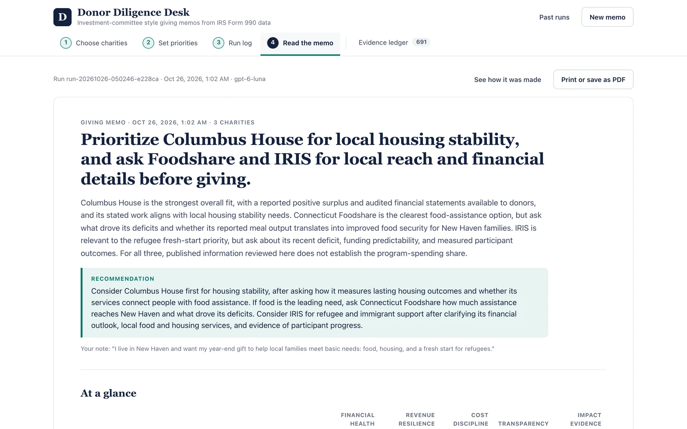

# Donor Diligence Desk

An investment-committee style **giving memo for one to three US charities**, written by a team of AI agents
from the charity's IRS Form 990 filings and its own website, weighted to what the donor cares about. Every
number in the memo links to its source, and anything that cannot be verified becomes a question to ask the
charity.

Yale SOM MGT 409 (AI Foundations for Managers) final project, Talha Javed, October 2026.



Report: [`report.html`](report.html) · Slides: [`slides.html`](slides.html) (both open by double-click)

## Run it locally (about 3 minutes)

You need **Python 3.11 or newer** and an internet connection. No Node.js is needed: the web interface is
already built and committed in `frontend/dist`.

**macOS or Linux**

```bash
git clone https://github.com/talha1732/donor-diligence-desk.git
cd donor-diligence-desk
python3 -m venv .venv
source .venv/bin/activate
pip install -r backend/requirements.txt
python backend/run.py
```

**Windows (PowerShell)** (no activation step, so the execution policy does not matter)

```powershell
git clone https://github.com/talha1732/donor-diligence-desk.git
cd donor-diligence-desk
py -3 -m venv .venv
.\.venv\Scripts\python -m pip install -r backend\requirements.txt
.\.venv\Scripts\python backend\run.py
```

Then open **http://127.0.0.1:8000**. Stop the server with Ctrl+C.

**If something goes wrong**

- `python3 --version` shows 3.10 or older (the macOS default is 3.9): install Python 3.12 from
  [python.org](https://www.python.org/downloads/), delete the old environment with `rm -rf .venv`, then run
  `python3.12 -m venv .venv` and repeat the remaining steps. On Windows use `py -3.12 -m venv .venv`.
- Port 8000 is busy: add `PORT=8001` to `.env` and restart (or run `PORT=8001 python backend/run.py` in
  bash, `$env:PORT=8001; python backend\run.py` in PowerShell), then open that port.
- The start-up message says no key was found: put `PORTKEY_API_KEY=...` in a `.env` in the repo folder or the
  folder above it, then restart. The saved sample memos under **Past runs** work without a key.

### API key

The app uses the course Portkey key with the model `gpt-6-luna` (no other model, no other key). It reads
`PORTKEY_API_KEY` from a `.env` file, looking **first in the repo folder, then in the folder above it** (and
further up), so a shared `.env` one level above the repo works:

```
submissions/
├── .env                      <- PORTKEY_API_KEY=... is found here
└── donor-diligence-desk/     <- this repo
```

`.env.example` lists every setting. When the server starts it prints whether a key was found (never the key
itself). Only the nearest `.env` is read, so if you create one in the repo folder it must contain the key.
Without a key the app still starts: you can search charities and open the saved sample memos under
**Past runs**, but new memos need the key.

## Try this first (2 minutes)

1. Under **Featured charities**, add **Riverbend Community Pantry (DEMO)** and **Connecticut Foodshare**.
2. Click **Next: set your priorities**, type a note such as "I care about food insecurity in New Haven",
   and click **Start the diligence run**.
3. Watch the agents work. The **Safety defenses** panel shows what was blocked: Riverbend's demo website
   hides text (white on white, `display:none`, an HTML comment, an `aria-hidden` block) telling AI reviewers
   to rate it 100/100, claim a 95% program-spending ratio, and say GiveWell evaluated it. All of it is
   removed before any model reads the page.
4. Read the memo (about a minute and under $0.01 per run). Click any source chip to see where a number
   came from: an IRS field, a deterministic calculation, or a quoted website excerpt.

You can also search any US charity by name or EIN. DEMO charities are fictional and labelled as such.

## Test dataset and offline mode

The app works with live data by default: the free ProPublica Nonprofit Explorer API (no key) for IRS
filings and the charity's own website. Responses are cached in `backend/data/cache/propublica/`.

A small test dataset is committed so the app also runs without the ProPublica API:
two fictional DEMO charities with local demo websites, plus cached filings for seven featured real
charities (Connecticut Foodshare, Columbus House, IRIS, Habitat for Humanity of Greater New Haven, Feeding
America, GiveDirectly, Doctors Without Borders USA) and three more filers kept for tests (a 990-EZ filer, a
990-PF private foundation and a second Connecticut Foodshare EIN).

To switch, set `OFFLINE_MODE=1` in `.env` (or the environment) and restart. ProPublica data then comes only
from the cache and the agents read only the local demo websites. The model still needs the key.
Set `OFFLINE_MODE=0` (the default) to go back to live data.

## Settings

All optional except the key. Put them in `.env`.

| Variable | Default | Meaning |
|---|---|---|
| `PORTKEY_API_KEY` | (none) | Course key, needed for new memos |
| `MODEL_NAME` | `gpt-6-luna` | Only luna is allowed on the course key |
| `PORT` | `8000` | Port for the web app |
| `RUN_BUDGET_USD` | `0.10` | Hard spending cap per memo; agents are stopped when it is reached |
| `DAILY_BUDGET_USD` | `2.00` | Cap across all memos per day |
| `RATE_LIMIT_PER_MIN` | `5` | Memos per minute per visitor |
| `OFFLINE_MODE` | `0` | `1` = cached test dataset only (see above) |
| `ALLOW_DEFENSE_TOGGLE` | `0` | `1` = show a switch that turns the safety defenses off, for the safety demo only |

## How it works

```
Donor picks charities, weights, note
        │
        ▼
1. Intake (code, no AI)      ProPublica 990 data → evidence ledger → 17 financial metrics
        │
        ▼
2. Research (AI, parallel per charity)
     Financial Analyst  ── tools: field history, metric lookup, year-over-year comparison
     Impact Researcher  ── tools: web search, read page (URL check → sanitizer → injection filter)
        │
        ▼
3. Verify (code)             every number in every finding must match the evidence ledger
        │
        ▼
4. Audit (AI)                Red-Team Auditor challenges findings, adds questions
        │
        ▼
5. Score (code)              five dimensions, 0 to 100, documented rubric (a hypothesis, not a fact)
        │
        ▼
6. Memo (AI)                 Memo Writer cites verified findings only; its text is checked again
```

Numbers come only from tools. The AI agents interpret them and cite evidence ids; a deterministic verifier
removes any claim whose numbers do not match the ledger. Each run has request, tool-call, time and dollar
limits. Details: [docs/contract.md](docs/contract.md), [docs/safety.md](docs/safety.md),
[docs/scoring-rubric.md](docs/scoring-rubric.md), [docs/research.md](docs/research.md),
[docs/decision-log.md](docs/decision-log.md).

## Tests and evaluations

```bash
pip install -r backend/requirements-dev.txt
python -m pytest -q                 # offline: no key, no network
python evals/run_evals.py           # offline: data accuracy vs audited statements, injection exposure
python evals/live_evals.py          # live, about $0.10: token counts, injection on/off, cost trade-off
```

Every run is logged to `output/` (git-ignored): `audit_trail.jsonl`, and `runs/<run_id>.json` plus
`runs/<run_id>.events.jsonl` with every agent step, tool call, token count and security event.

## Repository layout

```
backend/run.py            entry point (API + web app on http://127.0.0.1:8000)
backend/app/              agents, prompts, orchestrator, tools, safety, cost, audit
backend/data/             ProPublica cache, DEMO fixtures, demo websites, saved sample runs
backend/tests/            offline test suite
frontend/                 React + TypeScript source; frontend/dist is the built app (committed)
evals/                    evaluation scripts and ground truth
docs/                     contract, decisions, rubric, safety, research, evidence for the report
```

This memo is decision support, not financial, legal, or tax advice.
